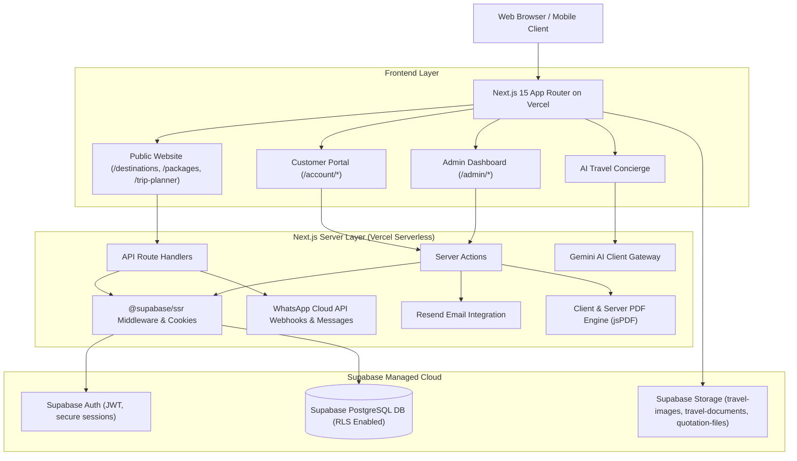

# THE TOUR VISION — COMPREHENSIVE PROJECT ARCHITECTURE & EXECUTION PLAN

**Business:** The Tour Vision  
**Location:** Pune, Maharashtra, India  
**Development Agency:** Automate Stack  
**Project Type:** Full-Stack Travel Agency Platform & Operations Management System  
**Deployment Target:** Vercel  
**Database & Auth & Storage:** Supabase (PostgreSQL, Supabase Auth with `@supabase/ssr`, Supabase Storage)

---

## 1. Executive Summary & Brand Identity

The Tour Vision is a premier travel agency operating out of Pune, Maharashtra, catering to luxury international getaways, curated domestic excursions, family holidays, honeymoon suites, adventure trails, and bespoke corporate travel.

This system is built by **Automate Stack** as an end-to-end, production-grade travel platform combining:
1. **Editorial Luxury Public Portal:** Seamless destination discovery, packaged tours, dynamic multi-currency display (INR default), interactive trip planner, AI concierge, and responsive lead captures.
2. **Robust CRM & Lead Engine:** Lead pipeline management from inquiry to confirmed travel, custom quotations with line-item calculations, PDF generation, automated customer follow-ups, and WhatsApp Cloud integration.
3. **Comprehensive Booking & Operational Engine:** Booking records, traveler manifests, payment tracking (strictly tracked as unverified/partial/paid without fake claims), voucher distribution, and itinerary builder.
4. **Self-Service Customer Portal:** Secure customer dashboard to review proposals, itineraries, vouchers, invoices, and inquiry history with strict Row Level Security (RLS).
5. **Role-Based Admin Command Center:** Real-time analytics computed directly from PostgreSQL tables, inventory management for destinations and packages, coupon & referral tracking, CMS blog, customer reviews, and site settings.

---

## 2. System Architecture

---

## 3. Database Entity Architecture

The PostgreSQL database enforces relational integrity, check constraints, indexed lookup columns, updated_at triggers, and strict Row Level Security policies across 20+ tables:

1. **`profiles`**: Linked directly to `auth.users(id)` with roles: `admin`, `staff`, `customer`. Contains full name, phone, city, avatar URL, preferences.
2. **`user_roles`**: System role mappings with strict role-escalation prevention functions.
3. **`destinations`**: Country, region, slug, overview, best season, hero image, gallery, travel tips, coordinates, publication status, featured flag.
4. **`package_categories`**: Honeymoon, Family, Adventure, Luxury, Weekend Getaways, Cultural, etc.
5. **`packages`**: Foreign key to destination and category, title, slug, duration (days/nights), base price, pricing type (per person / per couple), inclusions, exclusions, itinerary breakdown, accommodation grade, max/min travelers, published & featured status.
6. **`inquiries`**: CRM lead record capturing customer details, destination/package references, departure city, travel dates, passenger counts (adults/children), budget, source, status (`new`, `contacted`, `qualified`, `quotation_sent`, `confirmed`, `lost`), assigned staff, follow-up dates.
7. **`inquiry_notes`**: Internal team timestamped remarks for CRM history.
8. **`inquiry_status_history`**: Audit logs of pipeline status transitions.
9. **`quotations`**: Quotation reference number, customer/inquiry relation, total price, tax breakdown, discount, terms & validity date, status (`draft`, `sent`, `accepted`, `rejected`, `expired`), PDF storage path.
10. **`quotation_items`**: Line items for packages, hotel upgrades, private transport, visas, travel insurance, special activities.
11. **`bookings`**: Booking reference (e.g. `TTV-2026-XXXX`), customer ID, package ID, departure/return dates, passenger roster, total amount, currency, booking status (`pending`, `confirmed`, `in_progress`, `completed`, `cancelled`), payment status (`unpaid`, `pending`, `partially_paid`, `paid`, `refunded`), admin notes.
12. **`booking_status_history`**: Detailed audit trail for booking status changes.
13. **`itineraries`**: Custom day-by-day itineraries attached to inquiries or bookings with activity breakdowns and geo-points.
14. **`customer_documents`**: Private traveler documents (e.g., flight tickets, visas, vouchers) stored in private Supabase bucket.
15. **`reviews`**: Moderated customer reviews with destination tag, rating, comments, verified status, and publication toggle.
16. **`blog_posts`**: Travel articles, destination guides, SEO metadata, reading time, publication date.
17. **`coupons` & `coupon_redemptions`**: Percentage or fixed INR discounts with usage counters and expiry.
18. **`referrals`**: Customer referral codes with tracked signups and inquiry links.
19. **`ai_conversations` & `ai_messages`**: Anonymous or customer-linked travel conversation history for concierge context.
20. **`email_logs` & `whatsapp_logs`**: Outbound notification records with delivery statuses.
21. **`site_settings`**: Global agency settings, emergency contact, demo badge switch, SEO defaults, office address in Pune.
22. **`audit_logs`**: Admin security events, deletion actions, and role updates.

---

## 4. Implementation Phases

- **Phase 1: Foundation, Tooling, Supabase Migrations & Security**
  - Dependency configuration, Next.js App Router layout, Tailwind styling with luxury palette (Navy & Gold).
  - Complete SQL migration scripts in `supabase/migrations/` (19 comprehensive scripts + seed + admin bootstrap).
  - TypeScript types generated from database schema (`src/types/database.ts`).
  - Supabase client utilities (Browser client, Server client, Admin service-role client with server-only protection).
  - RLS rules, bootstrap admin script, and security guards.

- **Phase 2: Luxury Public Experience & Discovery**
  - Premium Editorial Homepage with hero destination search, departure city filter, featured packages, category grids, Pune agency story, customer reviews, newsletter, and demo badge.
  - Dynamic `/destinations` & `/destinations/[slug]` with interactive galleries, climate guides, and package relations.
  - Dynamic `/packages` & `/packages/[slug]` with day-by-day itineraries, inclusions/exclusions, pricing matrices, and instant inquiry/WhatsApp modals.
  - Category pages (`/categories/[slug]`), About Us, Contact, FAQ, and legal pages.

- **Phase 3: Interactive Trip Planner & AI Travel Concierge**
  - Multi-step smart trip planner (`/trip-planner`) capturing departure city, travel style, passenger breakdown, budget, and dates; generates real CRM inquiry with AI recommendation preview.
  - AI Travel Concierge (`/ai-travel-assistant` and floating assistant) powered by Google Gemini API with fallback graceful handling.

- **Phase 4: Customer Portal & Secure Authentication**
  - Customer registration, login, password recovery via Supabase Auth (`/auth/login`, `/auth/signup`, `/auth/reset-password`).
  - Customer dashboard (`/account`): view inquiries, live booking tracker, quotations review, downloadable travel vouchers, itinerary viewer, and profile settings.

- **Phase 5: Secure Admin Command Center & CRM Pipeline**
  - Secure `/admin/login` with server-side role verification via DB triggers and session tokens.
  - Real-time KPI dashboard computed directly from PostgreSQL (`/admin`): inquiries, conversion rate, recorded bookings, active leads, destination charts.
  - Comprehensive CRM (`/admin/inquiries`): filter by status, search, lead assignment, internal notes, follow-up alerts, WhatsApp direct trigger.
  - Destination & Package CRUD with image upload directly to Supabase Storage.

- **Phase 6: Quotation Builder, Booking Management & PDF Engine**
  - Quotation Builder (`/admin/quotations/new`): select inquiry, dynamic line items, taxes, discounts, instant branded PDF download and email dispatch.
  - Booking Management (`/admin/bookings`): track traveler records, real payment status states, vouchers, and status transitions.

- **Phase 7: Omnichannel Integrations, Marketing, & CMS**
  - WhatsApp Cloud API webhooks & click-to-chat triggers (`/api/whatsapp`).
  - Resend email templates for customer acknowledgements, admin lead alerts, and quotation delivery.
  - Blog & travel magazine engine (`/blog`, `/blog/[slug]`), review moderation (`/admin/reviews`), and coupon manager.

- **Phase 8: Production Polish, Security Verification, & Vercel Prep**
  - Mobile responsiveness verification across all screens.
  - Full TypeScript verification, production Next.js build validation.
  - Verification of `.env.example`, `SUPABASE_SETUP.md`, `DEPLOYMENT.md`, and `SECURITY.md`.
